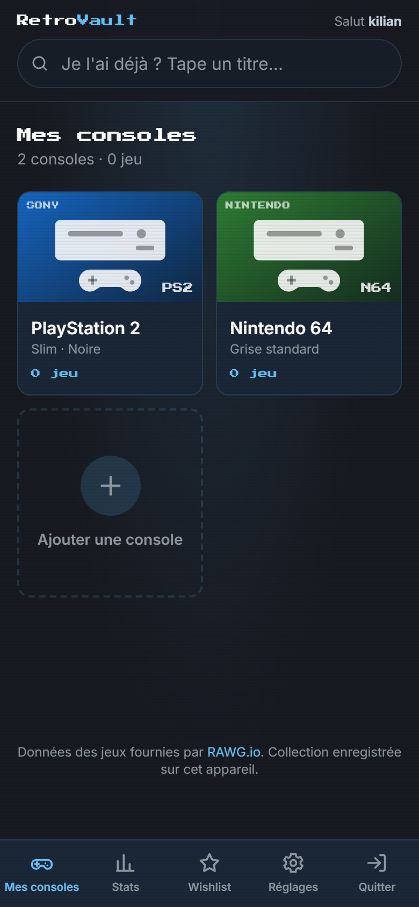
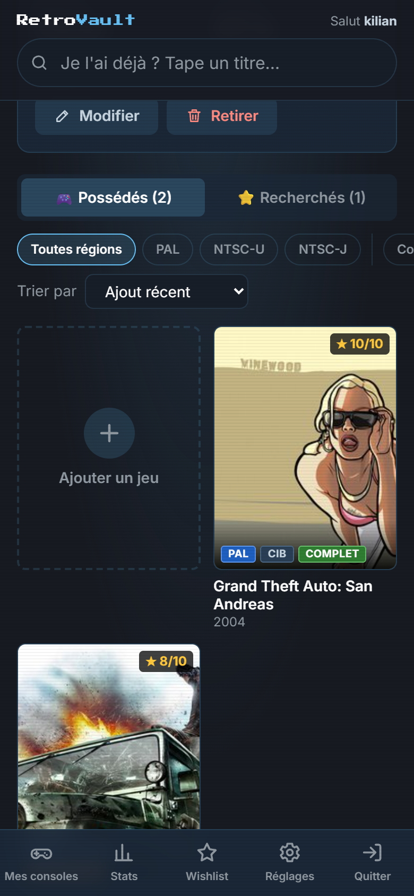
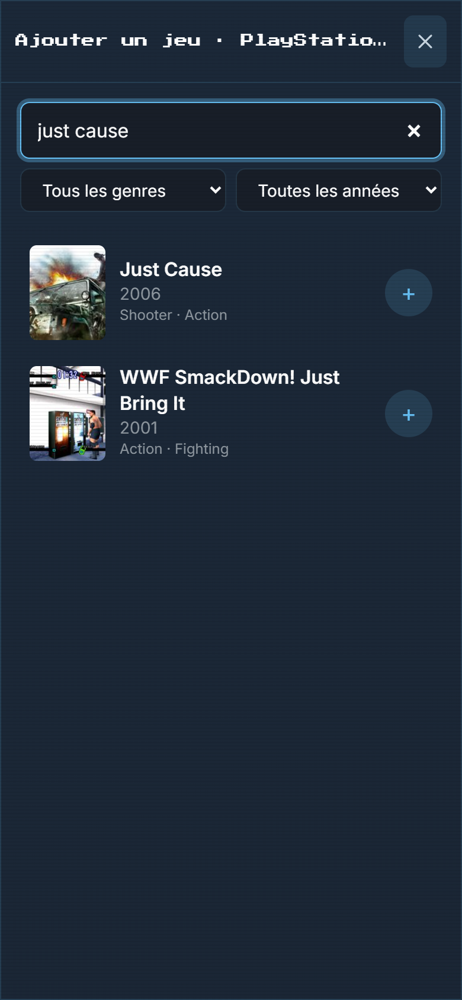
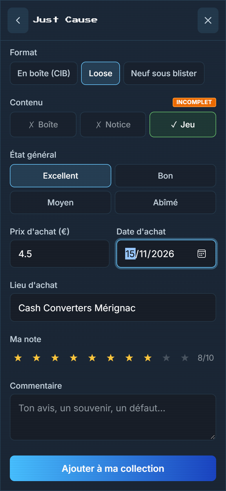
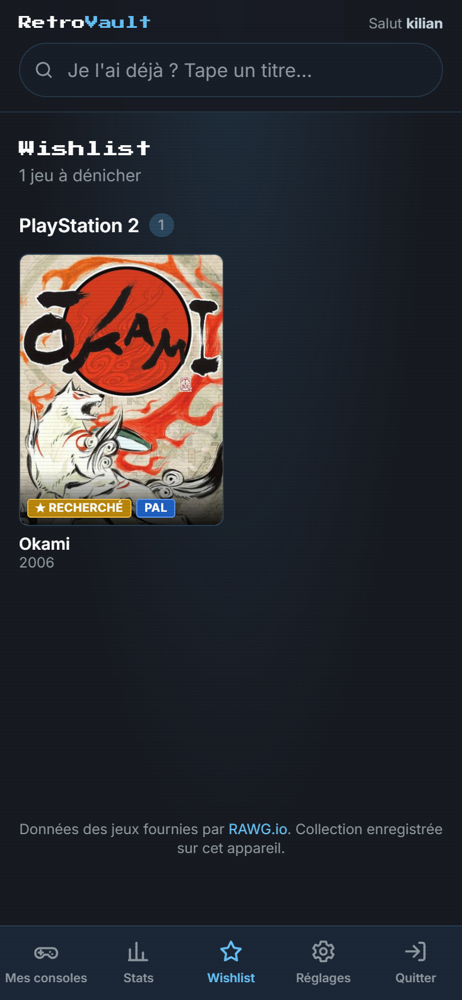
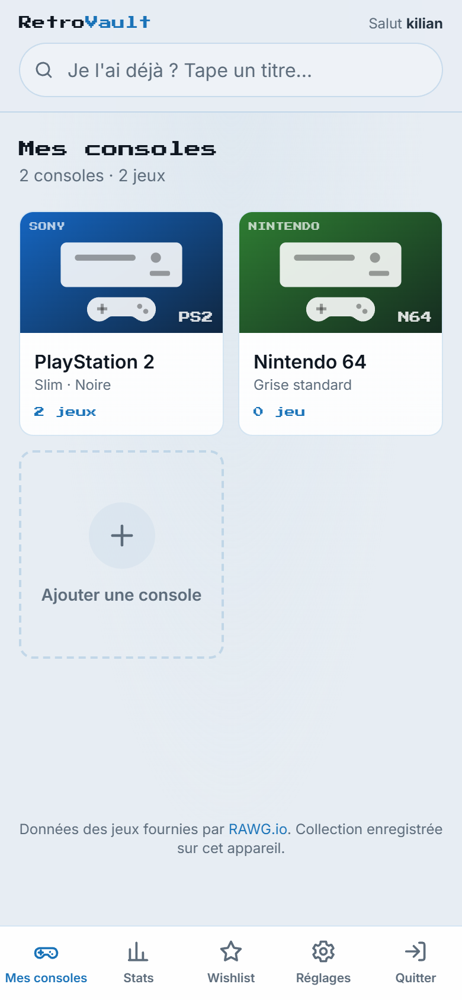
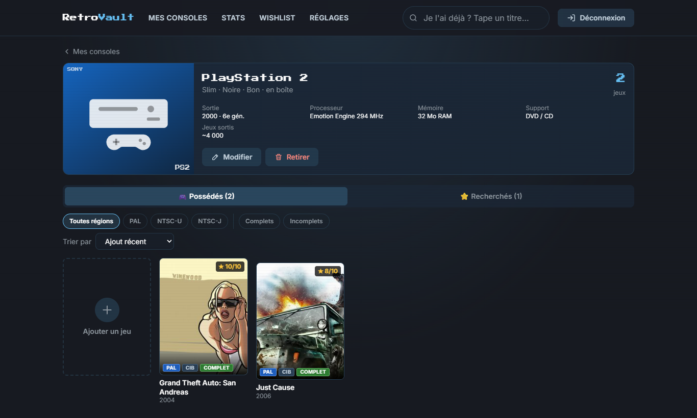

# RetroVault — ma collection de jeux rétro

Application web **React** pour gérer sa collection de consoles et de jeux vidéo, surtout rétro.
On se connecte, on ajoute ses consoles (avec le modèle exact : PS2 Fat ou Slim, Game Boy DMG ou Pocket…), puis pour chaque console on cherche ses jeux dans la base **RAWG** et on note l'état de son exemplaire : région, en boîte ou loose, complet ou non, prix payé, note perso…

Pensée **mobile d'abord** : une recherche « Je l'ai déjà ? » toujours visible permet de vérifier en magasin d'occasion qu'on n'achète pas un doublon.

<p align="center">
  
  
  
</p>

---

## Fonctionnalités

**Connexion**
- Inscription / connexion par pseudo et mot de passe, écran de démarrage façon BIOS rétro.
- Toutes les pages sont protégées, bouton de déconnexion dans la barre de navigation.
- Plusieurs comptes possibles sur le même appareil, chacun avec sa collection.

**Mes consoles**
- Grille de mes consoles avec une carte « + Ajouter une console ».
- Ajout en 3 étapes : choix dans un catalogue de **25 consoles** → **modèle** → état, boîte, couleur/édition, commentaire.
- Plusieurs exemplaires de la même console possibles (ex. une PS2 Fat et une Slim).
- Chaque carte affiche l'image, le nom, le modèle et le nombre de jeux.

**Jeux d'une console** (une seule page dynamique `/console/:id`)
- En-tête avec le modèle, les caractéristiques techniques et le nombre de jeux.
- Recherche RAWG **filtrée automatiquement sur la plateforme** (pas besoin de taper « ps2 »), avec filtres par genre et par année. Sans texte, la pop-up affiche les jeux les plus populaires de la console.
- Badge « Dans ma collection » sur les résultats déjà possédés.
- Options de mon exemplaire : région (PAL / NTSC-U / NTSC-J), format (**CIB / Loose / Neuf sous blister**), contenu boîte / notice / jeu → badge **Complet / Incomplet** automatique, état, prix, date et lieu d'achat.
- Fiche d'un jeu en pop-up : infos RAWG (résumé, genres, développeur, éditeur, date de sortie) + mes infos, note sur 5 ou sur 10, commentaire, modification et suppression avec confirmation.
- Filtres (région, complets / incomplets) et tri (ajout récent, A→Z, note, année).

**Bonus**
- **« Je l'ai déjà ? »** : recherche instantanée dans ma collection, sans réseau, qui répond console, région, format et état, ou « ⭐ Dans ta wishlist ».
- **Wishlist** : un jeu peut être « Recherché » au lieu de « Possédé ». Bouton « Je l'ai trouvé ! » pour le passer dans la collection.
- **Statistiques** (Recharts) : jeux par console, répartition CIB / Loose / Blister, % de jeux complets, répartition par région, total dépensé, top des jeux les mieux notés.
- **Réglages** : thème sombre / clair, effet CRT désactivable, note sur 5 ou 10.
- **Sauvegarde** : export et import de la collection en JSON.

## Stack technique

| Rôle | Outil |
|---|---|
| Interface | React 19 + Vite |
| Navigation | React Router |
| Style | Tailwind CSS 4, polices Press Start 2P (titres) et Inter (texte) |
| Animations | Framer Motion |
| État + persistance | Zustand (middleware `persist` → localStorage) |
| Graphiques | Recharts |
| Données des jeux | [API RAWG](https://rawg.io/apidocs) |

Pas de serveur : l'application est entièrement côté navigateur. Les comptes, la collection et les réglages sont enregistrés dans le `localStorage` de l'appareil.

## Installation

**Prérequis** : Node.js 20 ou plus.

1. Cloner le dépôt et installer les dépendances :
   ```bash
   git clone https://github.com/Vador634/retrovault.git
   cd retrovault
   npm install
   ```
2. Récupérer une clé API RAWG (gratuite) :
   - aller sur [rawg.io/apidocs](https://rawg.io/apidocs) et cliquer sur **Get API Key** ;
   - créer un compte, remplir le petit formulaire (nom de l'appli, description) ;
   - copier la clé affichée.
3. Copier `.env.example` en `.env` et y coller la clé :
   ```
   VITE_RAWG_KEY=ta_cle_ici
   ```
4. Lancer en développement :
   ```bash
   npm run dev
   ```
   puis ouvrir http://localhost:5173 et créer un compte.

**Version de production** :
```bash
npm run build     # génère le dossier dist/
npm run preview   # sert dist/ sur http://localhost:4173
```
Le dossier `dist/` est un site statique : il peut être déposé tel quel sur Netlify, GitHub Pages, Vercel…

> Le mot de passe est chiffré avec l'API Web Crypto du navigateur, qui n'est disponible qu'en **https** ou sur **localhost**. Pour utiliser l'appli sur téléphone, le plus simple est donc de la déployer sur un hébergeur statique en https (Netlify par exemple).

**Tests** de la logique métier (badge complet, recherche sans accents, notes) :
```bash
npm test
```

## Architecture


```
src/
├── main.jsx              Point d'entrée (thème appliqué avant le premier rendu)
├── App.jsx               Routes + protection des pages (RequireAuth)
├── index.css             Thèmes sombre/clair (variables CSS), composants de base, effet CRT
├── data/consoles.json    Catalogue des 25 consoles : modèles, specs, ID de plateforme RAWG
├── lib/
│   ├── rawg.js           Appels à l'API RAWG + mise en cache
│   ├── cache.js          Cache localStorage avec date d'expiration
│   ├── games.js          Régions, formats, états, « complet ? », formatage prix/dates, recherche sans accents
│   ├── consoles.js       Accès au catalogue
│   └── password.js       Hash PBKDF2 des mots de passe
├── store/
│   ├── auth.js           Comptes et utilisateur connecté
│   ├── collection.js     Consoles et jeux de chaque compte (ajouter / modifier / supprimer)
│   ├── settings.js       Thème, effet CRT, échelle de note
│   └── toast.js          Notifications
├── components/           Modal, formulaires, cartes, badges, recherche rapide…
└── pages/                Login, Consoles, ConsoleGames, Stats, Wishlist, Settings, NotFound
```

Le parcours d'un ajout : la page `ConsoleGames` ouvre `SearchGameModal` → `rawg.js` interroge `/games?platforms=15&search=…` → on choisit un résultat → `GameForm` → `ajouterJeu()` dans le store `collection` → Zustand enregistre dans le localStorage et toutes les pages se mettent à jour.

## Modèle de données


- Un **jeu** est rattaché à la console du **catalogue** (`consoleId: 'ps2'`) et pas à un exemplaire précis : si on a deux PS2, les jeux sont partagés entre les deux.
- Retirer le dernier exemplaire d'une console retire aussi ses jeux (après confirmation).
- Les notes sont toujours stockées **sur 10** ; l'affichage sur 5 divise simplement par 2.
- On ne garde de RAWG que ce qui sert à l'affichage de la grille (titre, image, date, genres). La fiche complète est rechargée à l'ouverture de la pop-up, avec un cache de 7 jours.

| Clé localStorage | Contenu |
|---|---|
| `retrovault-auth` | comptes (pseudo, sel, hash) + utilisateur connecté |
| `retrovault-collection` | consoles et jeux, rangés par pseudo |
| `retrovault-reglages` | thème, effet CRT, échelle de note |
| `rv-cache:*` | réponses RAWG mises en cache (genres, fiches de jeux) |

## Choix techniques

- **RAWG plutôt qu'IGDB** : IGDB demande un échange de jetons OAuth avec un secret et refuse les appels directs depuis un navigateur (CORS). Il faudrait donc un serveur. RAWG s'utilise directement depuis le front avec une simple clé.
- **ID de plateformes** : les 25 ID de `consoles.json` ont été vérifiés un par un avec l'endpoint `/platforms` de RAWG.
- **Régions** : RAWG ne fournit pas les dates de sortie par région, la région est donc une information de **mon exemplaire** (et sert aux filtres et aux statistiques).
- **Images des consoles** : aucune image protégée. Chaque console a une illustration générée en SVG avec sa couleur et son sigle. Pour utiliser ses propres photos, il suffit de les déposer dans `public/consoles/<id>.jpg` (ex. `ps2.jpg`) : elles sont prises en priorité.
- **Performance** : la page Statistiques (et Recharts) n'est chargée qu'à l'ouverture, les vignettes RAWG sont demandées redimensionnées, les recherches sont gardées en mémoire et annulées quand on tape plus vite que le réseau.

## Sécurité et limites

| Point | Ce qui est fait |
|---|---|
| Mots de passe | Jamais stockés en clair : PBKDF2-SHA256, 100 000 itérations, sel aléatoire par compte |
| Message d'erreur de connexion | Identique que le pseudo existe ou non |
| XSS | Tout l'affichage passe par React (pas de `dangerouslySetInnerHTML`) |
| Import de sauvegarde | Fichier vérifié (format, consoles connues) avant de remplacer la collection, avec confirmation |
| Clé RAWG | Dans `.env` (ignoré par git). Elle reste visible dans le code envoyé au navigateur : c'est le fonctionnement prévu par RAWG pour une clé gratuite |

Limite assumée : sans serveur, les données sont propres à un navigateur. L'export / import JSON sert à les sauvegarder ou à les transférer sur un autre appareil.

## Captures

| Connexion | Catalogue | Recherche RAWG | Options d'ajout |
|---|---|---|---|
|  |  |  |  |

| « Je l'ai déjà ? » | Statistiques | Wishlist | Thème clair |
|---|---|---|---|
|  |  |  |  |

Version ordinateur :




## Crédits

Données et images des jeux : [RAWG.io](https://rawg.io).

## Auteur

**Kilian Carasco** — étudiant en Bachelor Concepteur Développeur d'Applications (EPSI Bordeaux)
[Portfolio](https://kiliandev.netlify.app) · [GitHub](https://github.com/Vador634) · [LinkedIn](https://www.linkedin.com/in/kilian-carasco-029915399/)
